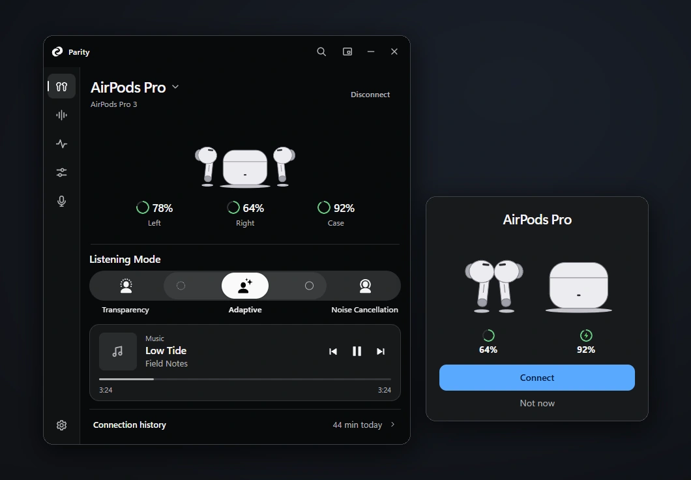
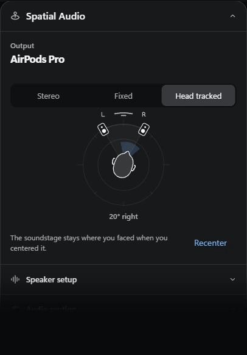

  

<h1 align="center">Parity</h1>

<strong>Your AirPods, at home on Windows.</strong>

  See what’s charged, switch listening modes, and control your audio from one desktop app.

  <a href="https://github.com/owenawsong/parity/releases"><strong>Releases</strong></a> ·
  <a href="#install">Install</a> ·
  <a href="#compatibility">Compatibility</a> ·
  <a href="docs/development.md">Build from source</a>

*Parity’s interface with sample device and playback data.*

## What you can do

| | |
| --- | --- |
| **Connect from the tray** | Open a recognized case near your PC to see a connection prompt. Check each AirPod and the case on the dashboard, with a timestamp when the last case reading is all that’s available. Choose separate left/right readings for the nearby popup in Settings. |
| **Change how you listen** | Switch between the modes your pair supports. Adjust Adaptive Audio, tune the on-device equalizer on supported firmware, or use Now Playing to control a compatible app. |
| **Try spatial audio on Windows** | Compare Stereo, Fixed, and Head Tracked with an interactive speaker diagram. Parity renders the spatial effect on the PC and can use AirPods motion to anchor the sound as you move. |
| **Set up your microphone** | Check the AirPods input, record and play back a sample, and tune voice processing. Supported models can keep stereo playback while using the AirPods mic through the WPods audio route. |
| **Explore the sensors** | Practice nod and shake gestures, assign shortcuts, or view live heart rate and past Pulse sessions on AirPods Pro 3. |

See Sound and Spatial Audio

 

  
  

## Install

Parity is in preview. The desktop package requires **Windows 10 (2004 or newer) or Windows 11 on x64**, the **.NET 10 Desktop Runtime (x64)**, and the **Microsoft Edge WebView2 Runtime**. AirPods controls use the existing **WPods Bluetooth service and its driver**.

1. Install and configure [WPods](https://github.com/FPNDev/wpods#install). Pair your AirPods in Windows and quit the WPods tray app before opening Parity. Leave its background service running.
2. Get the Windows x64 ZIP from [Releases](https://github.com/owenawsong/parity/releases) when a build is available. Extract the whole archive.
3. Open PowerShell in the extracted folder, run `.\Install-Parity.ps1`, and open **Parity** from Start.

To switch back, quit Parity from the tray and reopen WPods. The apps keep separate preferences and share the Bluetooth service.

## Compatibility

Listening controls adapt to the connected model. Other features, including on-device EQ, stereo microphone, and head tracking, also depend on what the model and firmware expose.

| AirPods family | Listening modes in Parity |
| --- | --- |
| AirPods 1–4 without ANC | Standard playback |
| AirPods Pro 1 and AirPods Max 1 | Off, Transparency, Noise Cancellation |
| AirPods 4 with ANC, AirPods 5, and AirPods Max 2 | Off, Transparency, Adaptive, Noise Cancellation |
| AirPods Pro 2 and AirPods Pro 3 | Transparency, Adaptive, Noise Cancellation. Off can be enabled in Advanced settings. |

**AirPods Pro 3** is the primary hardware test pair. The other model layouts and mode combinations have been checked with simulated devices. Nearby discovery and device controls may vary with the Bluetooth adapter, service version, and firmware.

Closed cases can stop reporting battery. Parity keeps the last known charge when it has one and shows when it was seen. Windows spatial audio processing in Parity depends on the selected playback route. Apple hearing setup is available on supported Apple devices.

## Build and report issues

- [Build and package Parity](docs/development.md), run its regression suites, or open the simulated interface without AirPods.
- [Report a bug or share a compatibility result](https://github.com/owenawsong/parity/issues/new/choose). Include the Parity version, AirPods model, and Windows build.

## Credits and license

Parity takes design inspiration from [MagicPods](https://magicpods.app/), [AirPodsDesktop](https://github.com/SpriteOvO/AirPodsDesktop), and Apple’s AirPods experience. Its Bluetooth and device-control code builds on [WPods by FPNDev](https://github.com/FPNDev/wpods).

Parity modifies WPods v0.4.1 (commit `0019866`). This Parity snapshot is dated **November 22, 2026** and is released under the [GNU General Public License v3.0](LICENSE). See [third-party notices](THIRD-PARTY-NOTICES.txt) for bundled dependencies and [upstream documentation](docs/wpods-upstream.md) for the original project documentation.

Parity is independent of Apple. AirPods and related Apple product names are trademarks of Apple Inc.
