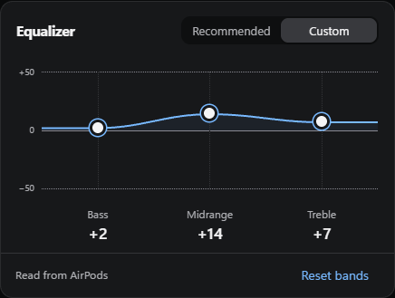
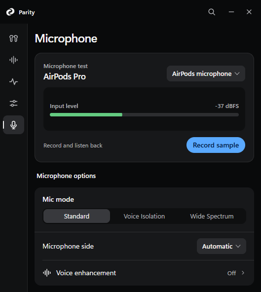
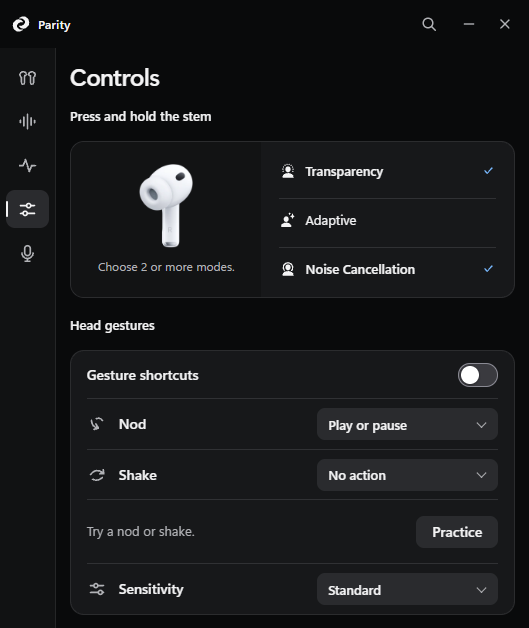
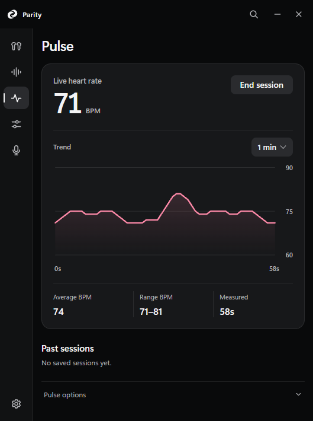

# Parity

**AirPods control for Windows.** Switch listening modes, see each battery, and control what's playing from the tray. Open Parity for on-device EQ, head-tracked spatial audio, microphone setup, and AirPods Pro 3 heart rate.

[Get the Windows preview](https://github.com/owenawsong/parity/releases) · [Installation](#install) · [AirPods compatibility](#compatibility) · [Build from source](docs/development.md)

**No Windows Test Mode. Secure Boot can stay on.** Parity's Bluetooth controls use the WPods service. WPods Setup handles the Microsoft-signed USB/IP driver, and PCs with the service already configured can go straight to installing Parity. [How the Bluetooth setup works](https://github.com/FPNDev/wpods#what-setup-changes)

## From the tray to your AirPods

| When you want to… | What Parity gives you |
| --- | --- |
| **Get connected** | A nearby prompt when you open a recognized case, a Connect button, and optional auto-connect for paired AirPods. |
| **Check the charge** | Separate left, right, and case readings. If the case stops reporting, you can see when Parity last heard from it. Open battery history from the dashboard and set a one-time charge alert. |
| **Change what you hear** | Transparency, Adaptive Audio, Noise Cancellation, and Off where supported. Adjust Adaptive Audio on compatible models and control Now Playing from the same page. |
| **See when you used them** | Connection history from the dashboard, including time connected today. |

## Sound

**Tune the AirPods themselves.** Use the recommended EQ or adjust bass, midrange, and treble on compatible firmware. Where supported, configure Conversation Awareness and Personalized Volume.

**Put sound around you.** Compare Stereo, Fixed, and Head Tracked in Parity's Windows spatial renderer. See the virtual speakers, recenter the stage, adjust speaker angle, or try a sample and your own audio file. Spatial processing depends on the Windows playback route.

See the equalizer and spatial audio

 

  
  

## Microphone

**Check your mic before the call.** See the AirPods input level, record a sample, play it back, and check which input Windows uses for calls. Supported combinations can use the AirPods microphone while keeping stereo playback. Choose the microphone side, switch between Standard, Voice Isolation, and Wide Spectrum, or select a processing model.

See the microphone workspace

 

## Controls and Pulse

**Make the controls yours.** Choose which listening modes the stem cycles through. Adjust press timing and chime volume, practice head gestures, and assign nod, shake, and keyboard shortcuts.

**See your heart rate on AirPods Pro 3.** View the live reading, zoom into the chart, or revisit a saved session. An optional local feed can show the latest reading in a streaming overlay or another app on the PC.

See Controls and Pulse

 

  
  

More device and Windows settings

- Ear detection with configurable playback resume, optimized charging on supported firmware, and options for one-ear noise cancellation.
- A Bluetooth signal view for finding a supported nearby case when it is broadcasting.
- Playback monitoring with a digital level meter, Windows audio routing tools, and a compact tray view.
- Light and dark appearance, reduced motion, sidebar order, app language, and startup settings.

## Install

Parity is available as a **Windows x64 preview**. You need Windows 10 (2004 or newer) or Windows 11, the **.NET 10 Desktop Runtime (x64)**, and the **Microsoft Edge WebView2 Runtime**.

1. **Set up Bluetooth once.** If the WPods service isn't already configured, run [WPods Setup](https://github.com/FPNDev/wpods#install). Pair your AirPods in Windows, then quit the WPods tray app and leave its service running.
2. **Install Parity.** Extract the Windows ZIP from [Releases](https://github.com/owenawsong/parity/releases) when a preview is available. Open PowerShell in that folder and run `.\Install-Parity.ps1`.
3. **Open Parity from Start.** Use the tray icon or open the AirPods case near your PC. To switch back to WPods, quit Parity from the tray and reopen WPods.

The README captures use the app's locally prepared AirPods artwork and demonstration device data. The downloadable preview ships with bundled illustrations.

## Compatibility

**AirPods Pro 3** is the primary pair tested with real hardware. Other model layouts and mode combinations have been checked in simulation. The controls shown depend on the model and firmware, and Bluetooth behavior can vary by Windows adapter.

| AirPods family | Listening modes in Parity |
| --- | --- |
| AirPods 1–4 without ANC | Standard playback |
| AirPods Pro 1 and AirPods Max 1 | Off, Transparency, Noise Cancellation |
| AirPods 4 with ANC, AirPods 5, and AirPods Max 2 | Off, Transparency, Adaptive, Noise Cancellation |
| AirPods Pro 2 and AirPods Pro 3 | Transparency, Adaptive, Noise Cancellation. Enable Off in Advanced settings. |

## Development and feedback

[Build or preview the app](docs/development.md) or [report a bug or share a hardware result](https://github.com/owenawsong/parity/issues/new/choose). Include your Parity version, AirPods model, Windows build, and Bluetooth adapter when reporting connection problems.

## Credits and license

Parity takes design inspiration from [MagicPods](https://magicpods.app/), [AirPodsDesktop](https://github.com/SpriteOvO/AirPodsDesktop), and Apple's AirPods experience. Its Bluetooth and device-control code builds on [WPods by FPNDev](https://github.com/FPNDev/wpods).

This modified version of WPods v0.4.1 (commit `0019866`) is dated **November 22, 2026** and is licensed under the [GNU General Public License v3.0](LICENSE). See the [third-party notices](THIRD-PARTY-NOTICES.txt) and [original WPods documentation](docs/wpods-upstream.md).

Parity is independent of Apple. AirPods and related Apple product names are trademarks of Apple Inc.
