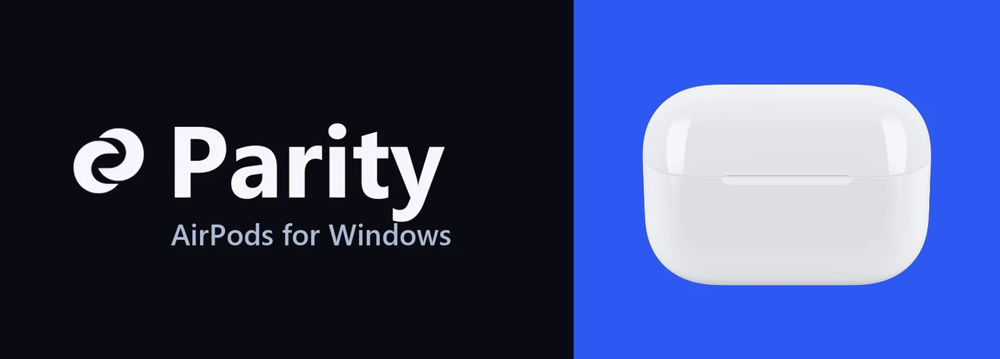
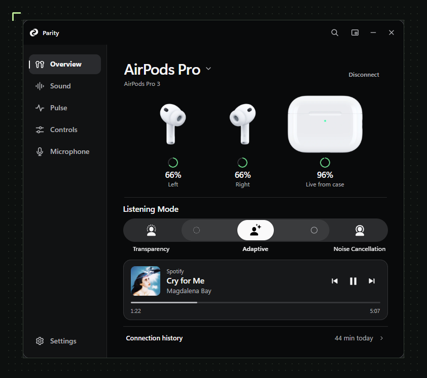

<h1>
  <picture>
    <source media="(prefers-reduced-motion: reduce)" srcset="docs/media/parity-banner.webp">
    
  </picture>
</h1>

**Control your AirPods from the Windows tray.** Switch listening modes, see what’s charged, and pick up what you were playing. Open the full app for on-device EQ, head-tracked spatial audio, microphone setup, and live heart rate on AirPods Pro 3.

[Get the Windows preview](https://github.com/owenawsong/parity/releases) · [Install](#install) · [See what works with your AirPods](#compatibility) · [Build from source](docs/development.md)

**Windows Test Mode is unnecessary. Secure Boot can stay on.** Parity Setup reuses the WPods Bluetooth service or opens [WPods Setup](https://github.com/FPNDev/wpods#what-setup-changes) to install it and the Microsoft-signed USB/IP driver.

## From the case to the tray

Open a recognized case near your PC and choose **Connect**. For a paired set you use every day, enable **Connect when nearby** to skip that step. The compact tray view is there when all you need is a battery check or a quick mode change.

Control playback from Overview, including seeking when the player supports it, or switch between the listening modes your AirPods expose. Pick Adaptive on a supported pair to adjust its balance between transparency and cancellation.

| In Overview | What you can do |
| --- | --- |
| **Battery** | See the left and right earbuds separately, with the case alongside. Open a reading for its charge history or set a one-time charge alert. |
| **Case status** | See a fresh reading while the case is reporting. When it goes quiet, Parity keeps the last reading with its age. |
| **Now Playing** | See the track, artwork, and player, then play, pause, skip, or seek when the Windows media session supports it. |
| **Connection history** | Check time connected today and see how much you used this pair over the past week. |

## Sound that fits how you listen

**On-device EQ.** The Recommended setting lets the earbuds manage their own tuning. Switch to Custom on compatible firmware to adjust bass, midrange, and treble. Parity sends the changes to your AirPods so you can hear them while you adjust.

**Spatial Audio on Windows.** Adjust the virtual speakers’ angle and level, see which way you’re facing, or use Recenter to set forward again.

| Mode | What it does |
| --- | --- |
| **Stereo** | Uses the normal left and right output. |
| **Fixed** | Uses Parity’s binaural renderer with the virtual speakers in a fixed position relative to you. |
| **Head Tracked** | Uses the same renderer and adjusts the direction as you move your head. |

Parity renders spatial audio on the PC. Live Windows playback needs a compatible audio route. **Audio routing** shows which applications are going through Parity, and **Sound Check** can play a directional sample or a local audio file before you change the Windows route. [Windows audio validation](docs/windows-audio-validation.md)

## Calls and physical controls

**Check the input before a call.** See the AirPods input level, record a sample, and listen back. Check the separate Windows call default and select the AirPods for apps that follow it. Choose the microphone side, switch between Standard, Voice Isolation, and Wide Spectrum, and choose a processing model. With a compatible pair and route, stereo playback can continue while the AirPods mic is in use.

**Get the stem and gestures right.** Pick the modes that press-and-hold cycles through, set press timing and tone volume, or bind keyboard shortcuts to actions you use from other apps. Practice nodding and shaking, adjust sensitivity, and assign each gesture to a shortcut such as play/pause or changing listening mode.

## Pulse

On AirPods Pro 3, start a recording to see your heart rate as it changes. Adjust the time window, check the session’s range and average, or open an earlier recording and inspect a specific part of it. An optional local feed supplies the latest reading to a streaming overlay or another app on the same PC.

Device and Windows settings

- **Playback behavior.** Automatic ear detection, a configurable resume window, Conversation Awareness, Personalized Volume, and sleep pause where supported.
- **Charging and case tools.** Optimized charging on supported firmware, battery history and alerts, and a nearby signal view for a case that’s broadcasting.
- **Listening controls.** Allow Off on supported models, allow Noise Cancellation with one earbud where available, and choose the stem’s listening modes.
- **PC audio tools.** Playback levels, microphone monitoring, voice enhancement, and Windows input and output controls. Parity’s digital playback meter reads signal level in dBFS, which is distinct from calibrated sound pressure at your ears.
- **Appearance.** Light and dark modes, reduced motion, adjustable window size, reorderable sidebar, startup, and language.

## Install

The preview runs on **Windows 10 (version 2004 or newer) and Windows 11 on x64**.

1. Download and open **Parity Setup** from [Releases](https://github.com/owenawsong/parity/releases). Quit an open Parity window from the tray before updating.
2. On a fresh PC, follow the WPods setup prompts to configure Bluetooth. Setup reuses an existing WPods service and installs the Microsoft desktop runtimes if they are missing. Restart if the Bluetooth setup requests it.
3. Pair your AirPods in Windows, quit the WPods tray app, and open **Parity** from Start. Keep the WPods Bluetooth service running.

To remove Parity, use **Installed apps** in Windows Settings. Parity keeps your preferences and leaves the shared service in place. [Private beta checklist](docs/private-beta.md)

## Compatibility

**AirPods Pro 3 is the primary pair tested with real hardware.** The other model layouts and listening-mode combinations below have been checked in simulation. Firmware, the Bluetooth adapter, and audio routing affect which features are available.

| AirPods family | Listening modes exposed in Parity |
| --- | --- |
| AirPods 1–4 without ANC | Standard playback |
| AirPods Pro 1 and AirPods Max 1 | Off, Transparency, Noise Cancellation |
| AirPods 4 with ANC, AirPods 5, and AirPods Max 2 | Off, Transparency, Adaptive, Noise Cancellation |
| AirPods Pro 2 and AirPods Pro 3 | Transparency, Adaptive, Noise Cancellation. Enable Off in Advanced settings. |

### A few common questions

**Why does the case sometimes show an older charge?** Some cases stop reporting while closed. Opening the lid or placing an earbud in the case can provide a new reading. Parity labels an older reading with the time since it last received one.

**Can I use Spatial Audio with any player?** The whole-PC and per-app routes depend on the endpoints Windows exposes. In Audio routing, check for **Through Parity** next to the player you want to hear. Sound Check is available for an independent test.

**Can I use the microphone and keep listening in stereo?** On supported hardware, the WPods route can expose an AirPods microphone alongside stereo playback. The Microphone page lets you check what Parity sees and what Windows is using for calls.

**Why do the AirPods look different in the download?** The package includes original Pro 3 renders and model-specific illustrations for other pairs. Some previews use the optional local artwork and motion clips. [Local artwork and motion tools](docs/local-artwork.md)

## Development and credits

- [Build Parity, preview the UI, and run checks](docs/development.md)
- [Read the Windows audio validation notes](docs/windows-audio-validation.md)
- [Report a problem or share a hardware result](https://github.com/owenawsong/parity/issues/new/choose)

Parity takes design inspiration from [MagicPods](https://magicpods.app/), [AirPodsDesktop](https://github.com/SpriteOvO/AirPodsDesktop), and Apple’s AirPods experience. Its Bluetooth and device-control code builds on [WPods by FPNDev](https://github.com/FPNDev/wpods).

This modified version of WPods v0.4.1 (commit `0019866`) is dated **November 22, 2026** and is licensed under the [GNU General Public License v3.0](LICENSE). See the [third-party notices](THIRD-PARTY-NOTICES.txt) and [original WPods documentation](docs/wpods-upstream.md).

Parity is independent of Apple. AirPods and related Apple product names are trademarks of Apple Inc.
